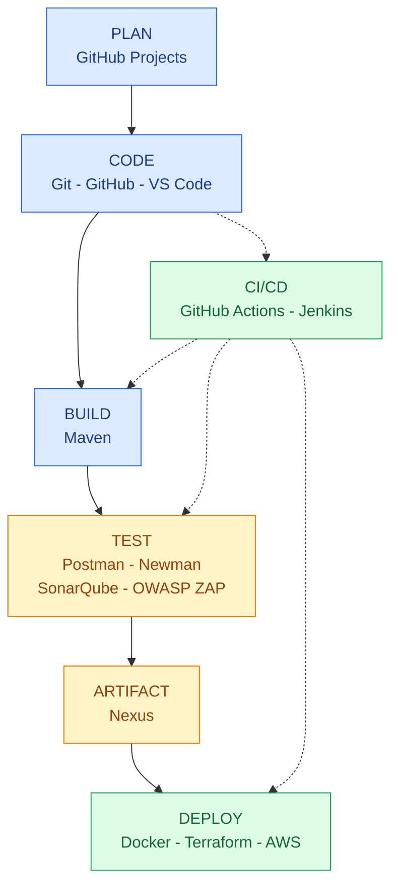

# LAB 2 - DEVOPS TOOLCHAIN MAP & CALMS

## 4.1. DevOps Toolchain Map

Sơ đồ gồm 7 nhóm giai đoạn và 15 công cụ DevOps.
Các đường nét đứt thể hiện CI/CD tự động hóa
quá trình build, test và deploy.

## 4.2. Bảng công cụ DevOps đã học

| Giai đoạn | Công cụ | Lab theo đề | Mục đích |
|---|---|---|---|
| Plan | GitHub Projects | - | Quản lý task, roadmap |
| Code | Git + GitHub | Lab 1, 5 | Quản lý mã nguồn |
| Code | VS Code | Lab 2 | Môi trường lập trình |
| Build | Maven | Lab 7 | Build dự án Java |
| Test | Postman/Newman | Lab 6 | Kiểm thử API |
| Test | SonarQube | Lab 6, 7 | Phân tích mã nguồn tĩnh |
| Test | OWASP ZAP | Lab 6 | Kiểm thử bảo mật |
| Deploy | Docker | Lab 2, 7, 8 | Container hóa ứng dụng |
| Deploy | Terraform | Lab 3 | Infrastructure as Code |
| Deploy | AWS | Lab 3 | Hạ tầng Cloud |
| CI/CD | GitHub Actions | Lab 1 | Tự động deploy website |
| CI/CD | Jenkins | Lab 7 | Tạo CI/CD pipeline |
| Artifact | Nexus | Lab 7 | Quản lý artifact |

## 4.3. CALMS trong thực tế

| Nguyên tắc | Hoạt động áp dụng | Lab |
|---|---|---|
| Culture | Team workflow với Git Flow và Code Review | Lab 5 |
| Automation | CI/CD pipeline tự động deploy website | Lab 1 |
| Automation | Script tự động thiết lập môi trường | Lab 2 |
| Lean | Docker tạo môi trường nhất quán | Lab 2 |
| Lean | Infrastructure as Code | Lab 3 |
| Measurement | Test reports và SonarQube metrics | Lab 6 |
| Measurement | Pipeline duration, success rate | Lab 7 |
| Sharing | Code Review trên GitHub | Lab 5 |
| Sharing | Chia sẻ DevOps Toolchain Map | Lab 2 |

## Kết luận

DevOps Toolchain hỗ trợ quá trình phát triển,
kiểm thử và triển khai phần mềm.

Việc áp dụng CALMS giúp tăng khả năng
cộng tác, tự động hóa, giảm lãng phí,
đo lường hiệu quả và chia sẻ kiến thức.
